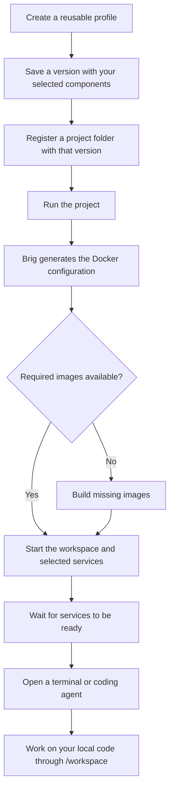

<p align="center">
  
</p>

# Brig

A development environment for every project, managed from your terminal.

Working across projects often means switching runtime versions, setting up
local databases again, and configuring coding agents. Brig turns that setup
into a reusable, versioned profile and gives each project its own Docker
environment. Your code stays in its local folder.

## What you can do

- Combine PHP, Python, Node.js, Go, Rust, and Java with the tools your project needs.
- Start PostgreSQL, MySQL, MariaDB, MongoDB, Redis, RabbitMQ, or Kafka alongside your workspace.
- Work with Claude Code, Codex, and OpenCode in the project environment.
- Reuse profiles across projects and apply updates when you choose.
- Manage everything through commands or an interactive terminal dashboard.

The interface is available in English, Spanish, and Portuguese.
See [supported components](docs/reference/components.md) for the full catalog.

## How it works

A **profile** defines your languages, tools, services, and agents. A **project**
connects a local folder to a saved version of that profile. Brig prepares and
starts the Docker environment when you run the project.



Editing a profile creates a new version. Existing projects keep their saved
configuration until you explicitly update them. Databases and agent history
persist when you stop and restart the environment.

## Get started

### 1. Install

You need Linux, Python 3.12 or newer, and [uv](https://docs.astral.sh/uv/).
Clone or download this repository and run from its folder as your regular user:

```bash
./scripts/install.sh
brig --help
```

The installer opens with a brig and shows brief Docker/Brig status messages.
Technical output appears on failure; use `./scripts/install.sh --verbose` for
live details. On supported Debian and Ubuntu hosts, it installs missing Docker
dependencies. Other Linux
distributions require Docker and Compose to be installed manually. If your user
is added to the Docker group, log out and back in before continuing.

If `brig` is not found, run `uv tool update-shell` and open another terminal.
Re-run the installer after updating this repository.
[Installation guide](docs/tutorials/first-project.md#1-prepare-your-machine).

### 2. Create an environment profile

```bash
brig profile create
```

Name it `python-dev`, choose Python and any tools or databases you need, then
select Codex as your agent and save. The wizard fetches available versions and
saves your choices as the first profile version.

### 3. Register your project and start working

```bash
mkdir -p ~/projects/my-api
cd ~/projects/my-api
brig project init
brig run my-api
```

In the wizard, name the project `my-api` and select `python-dev`. You can use an
existing project folder instead. The first run builds the environment and opens
its default agent at `/workspace`, where edits also change your local files.
If credentials are missing, Brig offers login or an API key before opening chat.
Login is reused across projects for the same agent, host user, and Brig data
directory. [Authentication guide](docs/how-to/credentials.md).

Exit the agent to return to your host; the environment stays running. Inside a
registered project folder, `brig run` opens the default agent and `brig run codex`
opens Codex if selected in the profile. Outside project folders, Brig offers a
project selector. Use `brig bash my-api` to open Bash instead.

Brig checks agent releases periodically and asks before updating. You can also
run `brig update my-api` explicitly. Updates rebuild installations and recreate
the environment while retaining project files, login, and persistent volumes.

Environment operations show compact status messages instead of raw Docker output.
Supported interactive terminals display a two-masted brig sailing over moving
waves while preparing and starting an environment. During `brig down`, the ship
sinks below the waves. Small terminals use a compact ship; redirected output, CI,
and `TERM=dumb` use plain text. The ship uses ASCII, and colors respect `NO_COLOR`.
Set `BRIG_NO_ANIMATION=1` to disable animation. Animations stop as soon as the
operation finishes and clear before opening a terminal or showing errors.
Use `brig up my-api --verbose`, `brig run my-api --verbose`, or the global
`brig --verbose …` option to see live Docker output. Failures automatically
include the final diagnostic output (up to 64 KiB).

## Everyday use

Run `brig` to open the dashboard, or use commands directly:

| Task | Command |
| --- | --- |
| List projects | `brig project list` |
| Link legacy code for read-only consultation | `brig reference add ../old-api --project my-api --as legacy` |
| Inspect a project's configuration | `brig project show my-api` |
| Start without opening a terminal | `brig up my-api` |
| Open Bash | `brig bash my-api` |
| Update agents | `brig update my-api` |
| Enter with a specific agent | `brig run my-api --agent codex` |
| Share an image or document with an agent | `brig attach ./design.png --project my-api` |
| Stop and remove containers, keeping persistent data | `brig down my-api` |
| Remove unused images from older configurations | `brig project clean my-api` |

Inside a registered project folder or its subfolders, `brig attach ./design.png`
detects the project automatically; elsewhere, use `--project NAME`.
Attachments are copied into the project. Brig prints the path you can give to
your agent; `brig project detach` or `brig down` removes the copies and keeps
the originals. Image cleanup keeps current images and images used by any
container, along with all volumes and data. Projects with identical build
configurations share development and credential proxy images while keeping
separate containers, networks, and project volumes. Project deletion keeps shared
images; cleanup can remove them when unused.

To change an environment and apply it to an existing project:

```bash
brig profile edit python-dev
brig down --project my-api
brig project update my-api
brig run my-api
```

You can also [inherit profiles](docs/how-to/projects.md#create-an-inherited-profile)
and [share them across machines](docs/how-to/import-profiles.md).
See [project management](docs/how-to/projects.md) and the
[command reference](docs/reference/cli.md) for more options.

## What to expect

Reference projects are available under `/references/ALIAS` without copying them.
Brig tells the agent which legacy resources are mounted and keeps them read-only.
Changes made while running remain pending; interactive `brig run` offers to apply
them and enter, warning that existing work-container sessions will close.
[Reference guide](docs/how-to/projects.md#consult-another-project-without-copying-it).

Brig prepares the development environment. You install your application's
dependencies and start its processes yourself; publishing application ports
requires manual setup.

Agents share the project workspace and run commands without tool approval
prompts. They can modify or delete project files and read secrets stored there.
Provider credentials managed through `brig auth` stay in separate credential
proxies. See [agent isolation](docs/how-to/agent-isolation.md) for the boundaries.

## Documentation and contributing

- [Your first project](docs/tutorials/first-project.md)
- [Documentation index](docs/README.md)
- [Architecture and execution flow](docs/explanation/architecture.md)
- [Troubleshooting](docs/how-to/troubleshooting.md)
- [Contributing](CONTRIBUTING.md)
