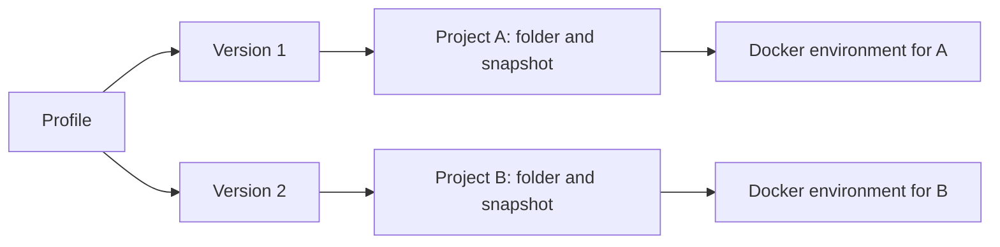
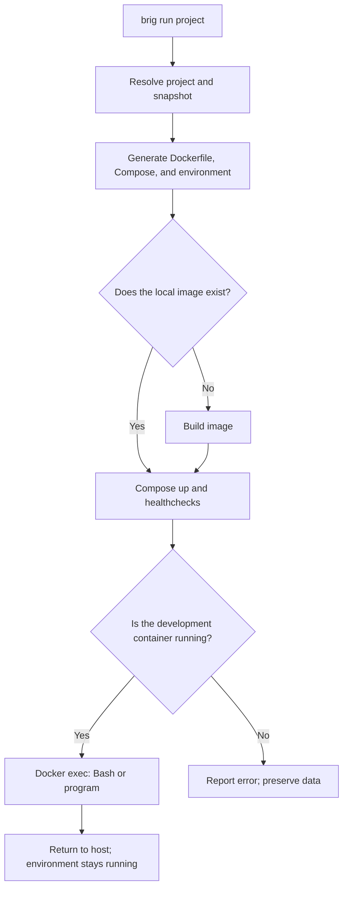
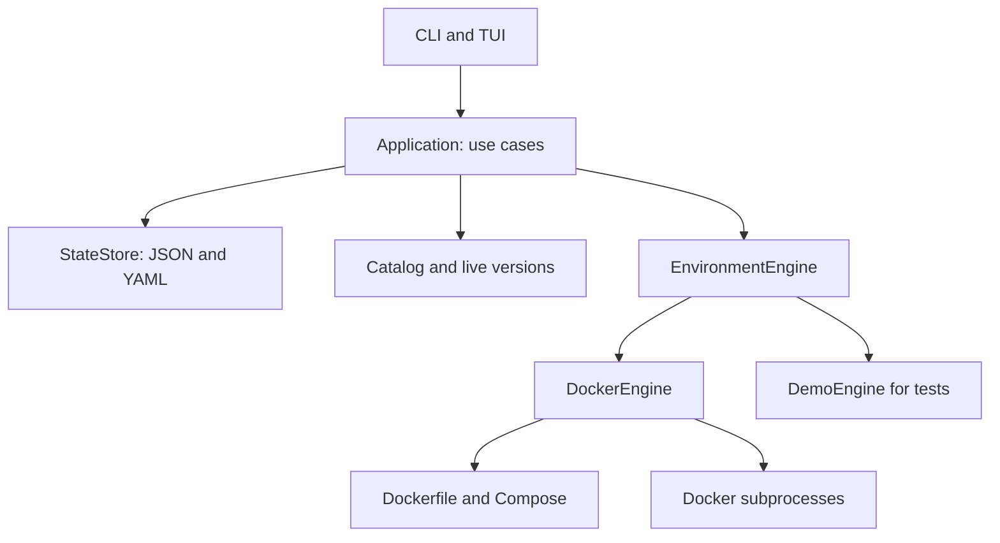

# How the system works

Brig separates environment definitions from execution. A profile describes
components; a project pins a version and a folder; the engine turns that
definition into a Docker environment owned by that project.

## Profiles, versions, and projects

A **profile** is reusable. It defines runtimes, tools, services, and a default
agent. Creating or editing a profile saves a version with concrete versions. Its
YAML document makes that version readable and shareable.

A **project** registers an existing folder and an independent snapshot of a
profile version. Two projects can use the same profile while retaining different
versions. Editing the profile does not change its projects. `brig project update`
applies the latest version to a stopped project.

Profile inheritance belongs to definition creation and storage. Each child
version pins one base version, includes its selections, and adds local components.
Base updates create new child versions only when requested. Relationships are
validated against cycles and protected deletion, including historical versions.
Projects receive the full configuration snapshot, so Docker executes the same
configuration flow for independent and inherited profiles.

The application loads `state.json`. It contains profile history and project
snapshots. YAML documents are written alongside versions, but the engine does
not reread them or apply manual edits.

## What happens during `brig run my-api`

1. The CLI loads state and looks up `my-api`. Without a name, it resolves the
   project from the current folder.
2. It checks for a terminal, unless `--command` specifies a program.
3. The engine acquires a local lifecycle lock for that project and checks Docker,
   Compose, and ownership of any existing development container.
4. It generates the Dockerfile from the project's snapshot. A hash of the
   Dockerfile and host UID/GID identifies the image and its build directory.
5. It checks existing volumes, preserves credentials, and generates Compose and
   private environment files.
6. If the image is missing locally, Compose builds it. The build context contains
   the Dockerfile, not project source files or credentials.
7. Compose creates or reuses containers, the network, and volumes. It waits for
   service healthchecks before starting the development container.
8. Brig records the successful startup and executes Bash at `/workspace` as the
   image's unprivileged user. With `--command`, it executes the specified program.

`brig up` prepares and starts the environment without entering it. `brig shell`
uses the same preparation flow before entering. `brig down` removes that
project's containers and network without deleting volumes.

## Images and services

PHP, Python, and Node.js use official images with pinned versions and Debian
Bookworm variants. They can share the development image. PHP is the base when
selected; without PHP, Python is the base when present. A Node.js-only profile
uses Debian Bookworm Slim as its base and incorporates the runtime from its
official image.

Mixed profiles can incorporate Python under `/opt/python` and Node.js under
`/opt/node`, avoiding replacement of PHP binaries. The generator discovers the
selected Python image's shared libraries and installs them in the final image.

Selected tools are added at their exact versions. Composer is copied from its
official image. pip and uv are installed with Python; npm, pnpm, and Yarn Classic
with npm. When pip or npm is not selected, the runtime's bundled version remains.

Database servers are not installed inside the development container. Each service
has its own container and data volume. Their versions also come from the snapshot.
PostgreSQL 18 and newer use the mount point matching those images' layout; the
engine accounts for this difference.

Volume labels record the project and the service's major version. Changing that
major version does not trigger an automatic migration.

## What isolation means

Each project has resource names derived from its internal ID, a Docker network,
and separate data, home, and conversation volumes. The development container mounts
the project's registered folder, its private volumes, and a shared volume for the
agent's login and global configuration. It does not mount the Docker socket or use
privileged mode.

Selected agents are installed as native executables during the image build.
Agent adapters in `components/agents.py` define installation, command, dependencies, and
configuration location. The profile selects which adapters to include and which one is the
default. A shared external volume keeps each agent's login per host user and Brig
data directory; nested per-project storage keeps conversation files separate.
`brig agent` prepares the environment and launches the selected executable with
an interactive terminal. The user follows the selected agent's authentication
or provider connection prompts.

The development container uses a user whose UID/GID matches the host user. Service
containers retain the users and permissions required by their official images.
Database ports are not published on the host. Containers share the host kernel;
isolation is not equivalent to a virtual machine.

Brig does not inspect source code to install dependencies or start a server.
These tasks currently run inside the terminal. A profile defines environment
tools, not application dependencies.

## Code layers

| Layer | Responsibility |
| --- | --- |
| `models` | Profiles, versions, projects, and state records |
| `components/` | Component/agent definitions, upstream providers, and declared requirements |
| `persistence/` | State decoding, JSON/YAML transactions, and file export |
| `application` | Creation, updates, deletion, and engine coordination |
| `docker/dockerfile`, `docker/compose`, `docker/services` | Generate definitions from the snapshot |
| `engine`, `docker/engine` | Execution contract and Docker lifecycle coordination |
| `docker/client`, `workspace`, `credentials`, `volumes` | Docker commands, private files/locks, credentials, and volume ownership |
| `ui/cli`, `ui/tui/`, `ui/presentation` | Arguments, interaction, and presentation |

Docker commands use argument lists without a host shell. The TUI suspends curses
while Docker displays progress or the external terminal is in use, then restores
the interface on return.

## State, errors, and limitations

The stored `running` field is Brig's last recorded state. Current status queries
and checks before updates or deletion inspect Docker. This detects changes made
outside Brig and services left running after a partial startup.

A failed build or startup is not recorded as successful. Compose may have created
some resources before failing; `down` removes them without deleting data. When
Docker does not respond, status is shown as unknown.

Exact versions pin the chosen releases but do not make a build immutable: image
tags are not pinned by digest and Debian packages are not individually locked.
Catalog compatibility checks declared tool requirements; each application's
dependencies need their own resolution and tests.
