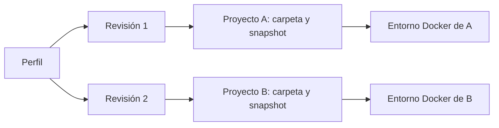
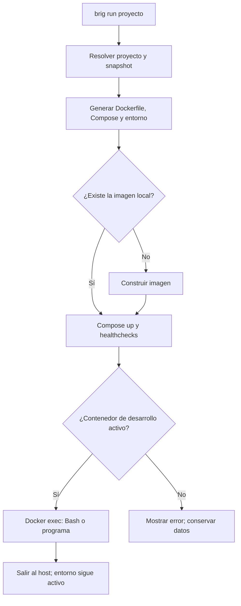
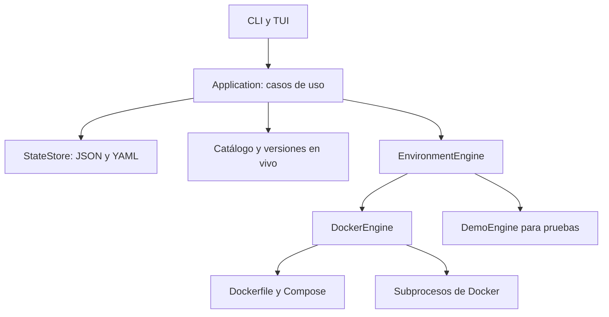

# Cómo funciona el sistema

Brig separa la definición del entorno de su ejecución. Un perfil describe los
componentes; un proyecto fija una revisión y una carpeta; el motor convierte esa
definición en un entorno Docker propio de ese proyecto.

## Perfil, revisión y proyecto

Un **perfil** es reutilizable. Define runtimes, herramientas, servicios y un
agente predeterminado. Crear o editar el perfil guarda una revisión con versiones
concretas. El YAML permite leer y compartir esa revisión.

Un **proyecto** registra una carpeta existente y una copia independiente de una
revisión del perfil. Dos proyectos pueden usar el mismo perfil y mantener
revisiones diferentes. Editar el perfil no cambia los proyectos que lo utilizan.
`brig project update` aplica la revisión más reciente a un proyecto detenido.

La fuente que carga la aplicación es `state.json`. Incluye el historial de
perfiles y los snapshots de los proyectos. Los YAML se escriben junto con las
revisiones, pero el motor no vuelve a leerlos ni aplica ediciones manuales.

## Qué ocurre en `brig run mi_api`

1. La CLI carga el estado y busca `mi_api`. Sin un nombre, resuelve el proyecto
   según la carpeta actual.
2. Comprueba que haya una terminal, salvo que se haya indicado `--command`.
3. El motor toma un bloqueo local para el ciclo de vida de ese proyecto y
   comprueba Docker, Compose y la propiedad del contenedor existente.
4. Genera el Dockerfile desde el snapshot del proyecto. El hash del Dockerfile
   y del UID/GID del host identifica la imagen y su directorio de construcción.
5. Comprueba los volúmenes existentes, conserva las credenciales y genera
   Compose y los archivos de entorno privados.
6. Si la imagen no existe localmente, Compose la construye. Su contexto contiene
   el Dockerfile, no el código del proyecto ni las credenciales.
7. Compose crea o reutiliza los contenedores, la red y los volúmenes. Espera las
   comprobaciones de salud de los servicios antes de iniciar el contenedor de
   desarrollo.
8. Brig registra el arranque exitoso y ejecuta Bash en `/workspace` como el
   usuario sin privilegios de la imagen. Con `--command`, ejecuta ese programa.

`brig up` hace la preparación y el arranque sin entrar. `brig shell` utiliza el
mismo flujo de preparación antes de entrar. `brig down` elimina los contenedores
y la red de ese proyecto, sin borrar los volúmenes.

## Imágenes y servicios

PHP, Python y Node.js usan imágenes oficiales con versiones concretas y variantes
Debian Bookworm. Pueden convivir en la imagen de desarrollo. PHP es la base si está
seleccionado; sin PHP, Python es la base cuando está presente. Un perfil que solo
incluye Node.js usa Debian Bookworm Slim como base e incorpora el runtime de su
imagen oficial.

En perfiles mixtos, Python puede incorporarse bajo `/opt/python` y Node.js bajo
`/opt/node`, evitando reemplazar los binarios de PHP. El generador descubre las
bibliotecas compartidas del Python seleccionado y las instala en la imagen final.

Las herramientas seleccionadas se añaden con su versión exacta. Composer se copia
de su imagen oficial. pip y uv se instalan con Python; npm, pnpm y Yarn Classic
con npm. Si no se seleccionan pip o npm, queda la versión incluida en el runtime.

Las bases de datos no se instalan dentro del contenedor de desarrollo. Cada
servicio tiene un contenedor y volumen de datos propios. Sus versiones también
proceden del snapshot. PostgreSQL 18 y posteriores usan el punto de montaje
correspondiente al diseño de esas imágenes; el motor contempla esa diferencia.

Las etiquetas de los volúmenes registran el proyecto y la versión mayor del
servicio. Cambiar esa versión mayor no provoca una migración automática.

## Qué significa aislamiento

Cada proyecto tiene nombres de recursos derivados de su ID interno, una red de
Docker y volúmenes propios. El contenedor de desarrollo monta únicamente la
carpeta registrada del proyecto y su volumen de home. No se monta el socket de
Docker ni se usa modo privilegiado.

El contenedor de desarrollo utiliza un usuario cuyo UID/GID coincide con el
usuario del host. Los servicios mantienen los usuarios y permisos que necesitan
sus imágenes oficiales. Los puertos de las bases de datos no se publican en el
host. Los contenedores comparten el kernel del host; el aislamiento no equivale
a una máquina virtual.

Brig no inspecciona el código para instalar dependencias o iniciar un servidor.
Por ahora, esas tareas se hacen dentro de la terminal. El archivo del perfil
define herramientas del entorno, no dependencias de la aplicación.

## Capas del código

| Capa | Responsabilidad |
| --- | --- |
| `models` | Registros de perfiles, revisiones, proyectos y estado |
| `catalog`, `versions`, `compatibility` | Componentes, proveedores y requisitos declarados |
| `storage`, `profile_yaml` | Validación y persistencia local |
| `application` | Creación, actualización, borrado y coordinación del motor |
| `dockerfile`, `compose` | Generación de definiciones a partir del snapshot |
| `engine`, `docker_engine` | Contrato de ejecución y operaciones reales con Docker |
| `cli`, `tui`, `presentation` | Argumentos, interacción y presentación |

Los comandos de Docker se ejecutan con listas de argumentos, sin shell del host.
La TUI suspende curses mientras Docker muestra progreso o se utiliza la terminal
externa, y restaura la interfaz al volver.

## Estado, errores y límites

El campo `running` guardado es el último estado registrado por Brig. Las consultas
actuales y las comprobaciones antes de actualizar o borrar consultan Docker. Esto
permite detectar cambios hechos fuera de Brig y servicios que quedaron activos
tras un arranque parcial.

Una construcción o un arranque fallido no se registra como éxito. Compose puede
haber creado algunos recursos antes de fallar; `down` permite retirarlos sin
borrar datos. Si Docker no responde, el estado se muestra como desconocido.

Las versiones exactas fijan los releases elegidos, pero no convierten la imagen
en una construcción inmutable: los tags no están fijados por digest y los
paquetes de Debian no están bloqueados individualmente. La compatibilidad del
catálogo verifica requisitos declarados de herramientas; las dependencias de
cada aplicación necesitan su propia resolución y pruebas.
